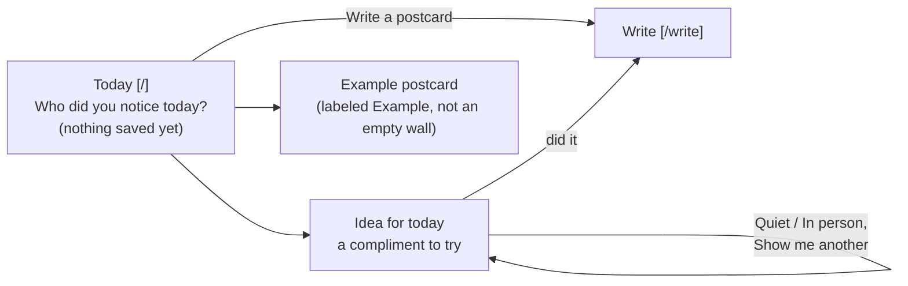
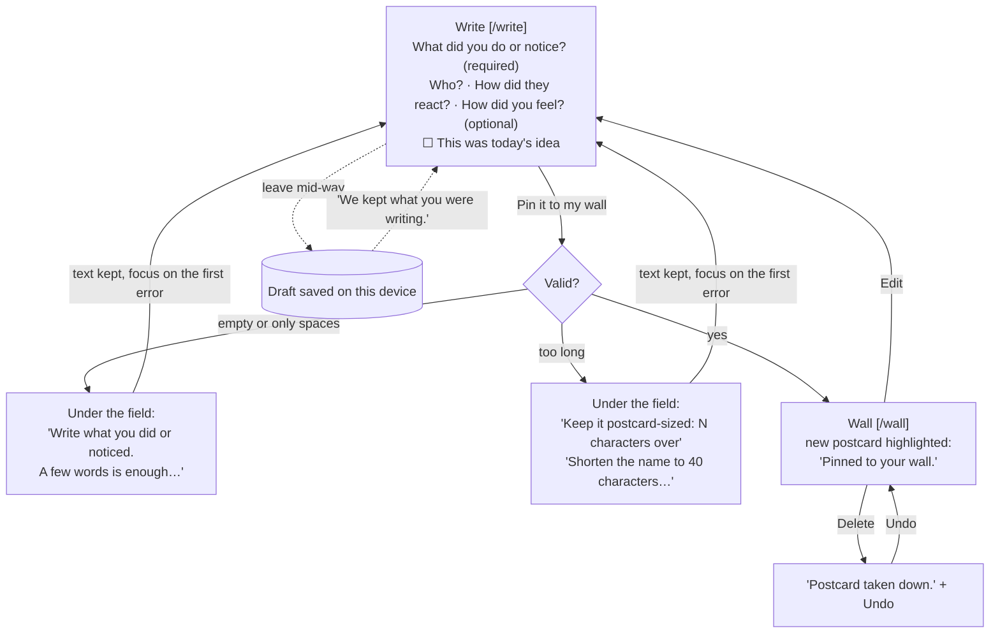
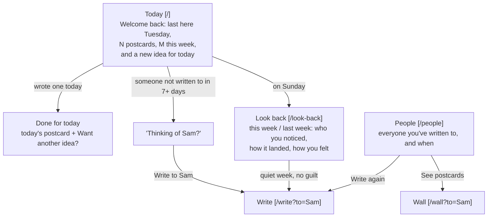

# Kind Regards

**A daily kindness log, kept as a wall of postcards.** Do something kind for someone, write it on a postcard, and pin it to your wall. Each day brings a small idea, people you haven't appreciated in a while come back to mind, and on Sunday you look back at everyone you noticed that week.

**Live:** _Vercel URL coming soon_ · Design, Build, Ship (MPCS 51238), Assignment 3: Patterns & Flows

> I do something kind → I write it on a postcard → it's pinned to my wall → I come back tomorrow for a new idea, and on Sunday I look back at everyone I appreciated.

There's no sign-in and no server. Everything is saved in this browser's `localStorage`, so it remembers you on the device you used.

## Flows

These are the three flows (first visit, main task, coming back). The source is in [`flows.md`](flows.md).

### 1 · First visit: useful right away



### 2 · Main task: write it down and pin it



### 3 · Coming back: it remembers



### States each page handles

| Page | States |
|---|---|
| Today | Loading (a brief skeleton while localStorage is read) · first visit · returning · done for today · Sunday · person to revisit |
| Write | New · prefilled name (`?to=`) · edit (`?edit=`) · edit of a deleted postcard · draft restored · errors |
| Wall | Empty (an example postcard, labeled) · list · just pinned · updated · deleted with Undo · filtered by person |
| People | No names yet (only strangers, or none) · list, with "7+ days" marked |
| Look back | This week · last week · a quiet week (no guilt) |
| Every page | The browser won't save (private mode): a notice that postcards won't be kept |

## Pages

Each step in the flow has its own route, and every page shares the same nav. The current page shows as a sunken wood tab with `aria-current="page"`.

| Route | What it's for |
|---|---|
| `/` Today | **First visit:** today's idea, the Write a postcard button, and an example postcard. **Returning:** a welcome back message, today's idea, someone to revisit, and a Sunday look-back link. Shows "Done for today" once you've written one. |
| `/write` | The one-column postcard form. It also handles editing (`?edit=`) and prefilling a name (`?to=`). |
| `/wall` | Every postcard, newest first, with a running total. Edit, Delete (with Undo), and filter by person. |
| `/people` | Everyone you've written to, how often, and when you last did. Anyone at 7+ days is marked. |
| `/look-back` | This week or last week: who you noticed, how it landed, and how you felt. |

## Design decisions

**Who it's for:** me, someone who wants to thoughtfully appreciate the people around them a little every day.

- **One way to log anything.** Any kind act counts, so there's a single **Write a postcard** action. The daily idea is a nudge, not an assignment. If you used it, you tick "This was today's idea."
- **Ideas use a "notice, then say" voice.** For example: "Notice one thing about someone's style… and tell them what caught your eye." **Quiet / In person** lets you match the idea to your energy that day. On Sundays the first idea is one for yourself.
- **A postcard wall, not a jar.** The research found the jar already taken by Happyfeed's "Happiness Jar" and a "Gratitude Jar" app. Postcards are addressed to someone, which suits an app about people.
- **People come first.** Postcards carry an optional name (blank is fine for strangers). That powers the People page and the gentle "Thinking of Sam?" nudge.
- **Reflection is optional.** "How did they react?" and "How did you feel after?" are optional. They give the Sunday look-back something to show.
- **No streaks.** The count is a running total that never resets. A quiet week gets "there's nothing to catch up on," never a warning.
- **Visual style.** Cozy Pixel from my Assignment 2 (parchment, wood, pixel edges, and Pixelify Sans with Lora) meets a Life is Strange-style journal: a golden-hour sky, taped postcards, handwritten notes, and postmarks. No butterflies, Polaroids, or other signature elements were copied.

### Onboarding research

Subagents studied how three similar tools welcome someone new. The full notes are in [`research.md`](research.md).

| Tool | First screen | What it asks | Time to value | What we took / avoided |
|---|---|---|---|---|
| Duolingo | "Learn for free. Forever." | 7–10 questions; the account comes *after* the first lesson | about 90 s | **Took:** the first real action before any setup. **Avoided:** streak guilt, mascot nagging. |
| Happyfeed (now Orca) | An account form | Name, email, password, *before* any value | Right after sign-up | **Took:** scheduled look-backs. **Avoided:** the jar, shake-for-random, sign-up first. |
| Random Acts of Kindness | Free resources, no sign-up | Nothing | One click to an idea | **Took:** an idea right away, asking for nothing. **Avoided:** their wording, calendars, terms. Filled their gap: no way to log or reflect. |

So the first visit asks for nothing. It opens on a compliment idea and one button, with an example postcard instead of an empty wall.

## The form

- **Layout:** one column, with a real `<label>` on every field. Optional fields say so.
- **Errors:** each one sits right under its field (linked with `aria-describedby`, marked with `aria-invalid`) and says what to do next:
  - Empty or only spaces: "Write what you did or noticed. A few words is enough, like 'told Sam the talk was clear.'"
  - Too long: "Keep it postcard-sized: 12 characters over."
  - Long name: "Shorten the name to 40 characters, or use a nickname."
- **What you typed is never cleared.** Focus moves to the first error. A live counter shows how close you are to 280 characters.
- **Drafts:** an unsent draft is saved on the device as you type, and comes back with "We kept what you were writing."

## Accessibility

- **Keyboard:** everything works with a keyboard. There's a skip link, a square cocoa focus outline on every control, and focus moves sensibly after deleting (to the heading) and undoing (back to the card). The tab order was checked in a headless browser.
- **Labels:** real labels on all fields. Toggle chips use `aria-pressed` and show a check, so state doesn't rely on color alone. The toast and loading states are announced with `role="status"`.
- **Motion:** `prefers-reduced-motion` turns off the pin-in animation.
- **Contrast:** checked with the agent by a script (`npm run contrast`) over every color pair the UI uses:

| Use | Foreground | Background | Ratio | Needs | Result |
|---|---|---|---|---|---|
| Body text on the page | text #3b2a20 | bg #f7ecd6 | 11.65:1 | 4.5:1 | Pass |
| Text on cards and in inputs | text #3b2a20 | surface #fff8ea | 12.92:1 | 4.5:1 | Pass |
| Hints and meta on the page | muted #6e5644 | bg #f7ecd6 | 5.82:1 | 4.5:1 | Pass |
| Hints and meta on cards | muted #6e5644 | surface #fff8ea | 6.46:1 | 4.5:1 | Pass |
| Skeleton and shelf labels | muted #6e5644 | sunken #efdcb6 | 5.06:1 | 4.5:1 | Pass |
| Main button label | text #3b2a20 | accent #f08a24 | 5.44:1 | 4.5:1 | Pass |
| Main button, hover | text #3b2a20 | accent-hover #f5ab5f | 7.07:1 | 4.5:1 | Pass |
| Main button, pressed | text #3b2a20 | accent-pressed #e18024 | 4.76:1 | 4.5:1 | Pass |
| Secondary button, hover | text #3b2a20 | hover #f2d9bc | 10.03:1 | 4.5:1 | Pass |
| Secondary button, pressed | text #3b2a20 | pressed #e8c39b | 8.26:1 | 4.5:1 | Pass |
| Selected chip and current nav tab | surface #fff8ea | wood #8a4a24 | 6.44:1 | 4.5:1 | Pass |
| Success notice | text #3b2a20 | success #6aa84f | 4.76:1 | 4.5:1 | Pass |
| Field error text on cards | error #b3361f | surface #fff8ea | 5.73:1 | 4.5:1 | Pass |
| Field error text on the page | error #b3361f | bg #f7ecd6 | 5.17:1 | 4.5:1 | Pass |
| Handwriting and postmark on postcards | ink #3a3f6b | surface #fff8ea | 9.45:1 | 4.5:1 | Pass |
| Idea stamp label | text #3b2a20 | tape-gold #f6c945 | 8.69:1 | 4.5:1 | Pass |
| Welcome banner, look-back summary, 'days ago' badge | text #3b2a20 | sky-1 #ffd9a0 | 10.20:1 | 4.5:1 | Pass |
| Handwritten names in the look-back summary | ink #3a3f6b | sky-1 #ffd9a0 | 7.46:1 | 4.5:1 | Pass |
| Toast text | surface #fff8ea | text #3b2a20 | 12.92:1 | 4.5:1 | Pass |
| Control edges on the page | wood #8a4a24 | bg #f7ecd6 | 5.81:1 | 3:1 | Pass |
| Control edges on cards | wood #8a4a24 | surface #fff8ea | 6.44:1 | 3:1 | Pass |
| Error edge on inputs | error #b3361f | surface #fff8ea | 5.73:1 | 3:1 | Pass |
| Focus outline | text #3b2a20 | bg #f7ecd6 | 11.65:1 | 3:1 | Pass |
| Toast action focus | accent #f08a24 | text #3b2a20 | 5.44:1 | 3:1 | Pass |

24 of 24 pairs pass.

## First-run check

_Pending: once it's deployed, an agent will use the live site as a brand-new user, and its usability feedback and the fixes made will go here._

## My reflection

_To be written by me: how I worked with the agent, what was easy, and what was hard._

## Run it locally

```bash
npm install
npm run dev       # http://localhost:3000
npm run build     # production build
npm run lint
npm run contrast  # contrast check
```

Built with Next.js 16 and Tailwind CSS 4. No other runtime dependencies, no database, no external APIs. Deployed on Vercel's Hobby plan.
