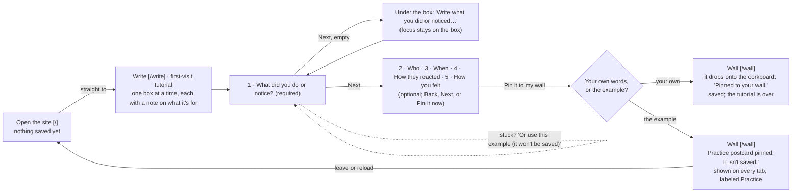
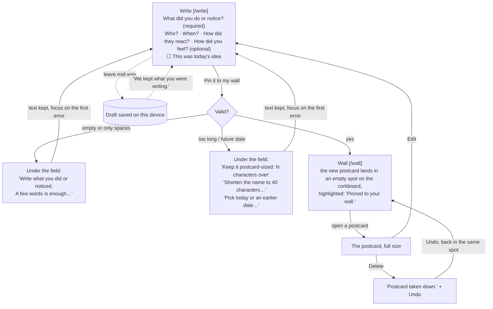
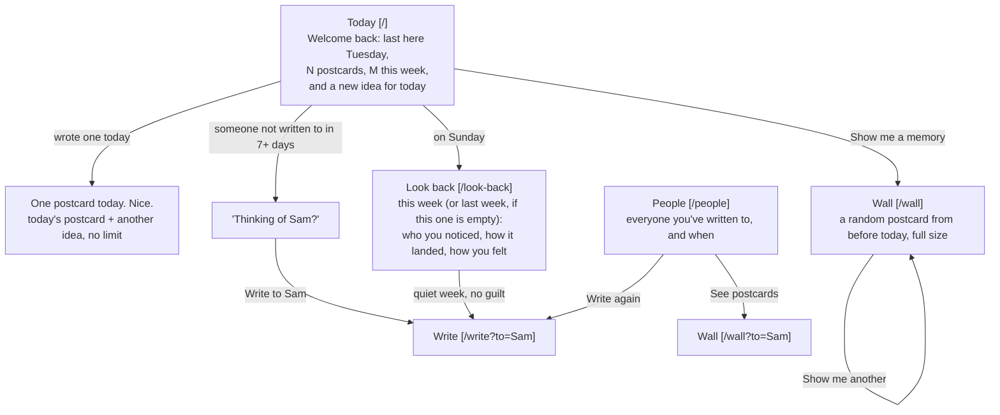

# Kind Regards

**A daily kindness log, kept as a wall of postcards.** Do something kind for someone, write it on a postcard, and pin it to your wall. Each day brings a small idea, people you haven't appreciated in a while come back to mind, and on Sunday you look back at everyone you noticed that week.

**Live:** https://dbs-p3.vercel.app · Design, Build, Ship (MPCS 51238), Assignment 3: Patterns & Flows

> I do something kind → I write it on a postcard → it's pinned to my wall → I come back tomorrow for a new idea, and on Sunday I look back at everyone I appreciated.

There's no sign-in and no server. Everything is saved in this browser's `localStorage`, so it remembers you on the device you used.

## Flows

These are the three flows (first visit, main task, coming back). The source is in [`flows.md`](flows.md).

### 1 · First visit: useful right away



### 2 · Main task: write it down and pin it



### 3 · Coming back: it remembers



### States each page handles

| Page | States |
|---|---|
| Today | Loading (a brief skeleton while localStorage is read) · first visit (goes straight to the Write tutorial) · nothing saved after practice (one button and the idea) · returning · wrote one today · Sunday ("For you" idea; links to last week if this week is empty) · person to revisit |
| Write | First-visit tutorial (one box at a time, example offered, practice not saved) · new · prefilled name (`?to=`) · edit (`?edit=`) · edit of a deleted postcard · draft restored · errors · Earlier date · Other feeling |
| Wall | Practice postcard (labeled, removable, not saved) · empty (an example postcard on the board, labeled) · board · full board (cards overlap, newest on top) · postcard opened · a memory · just pinned · updated · deleted with Undo · filtered by person |
| People | No names yet (only strangers, or none) · list, with "7+ days" marked |
| Look back | This week · last week · a quiet week (no guilt) · edited (back on that postcard's week) · deleted with Undo |
| Every page | The browser won't save (private mode): a notice that postcards won't be kept |

## Pages

Each step in the flow has its own route, and every page shares the same nav. The current page shows as a sunken wood tab with `aria-current="page"`.

| Route | What it's for |
|---|---|
| `/` Today | **First visit:** goes straight to the Write tutorial. **Returning:** a welcome back message, today's idea, someone to revisit, a Sunday look-back link, and **Show me a memory** (opens a past postcard on the wall). After one postcard: "One postcard today. Nice." |
| `/write` | **First visit:** the tutorial, one box at a time with a note on what each is for, and the example offered. **After that:** the one-column postcard form. It also handles editing (`?edit=`) and prefilling a name (`?to=`). |
| `/wall` | A pixel corkboard with every postcard pinned small, and a running total. Open a postcard to read it full size, Edit, or Delete (with Undo). **Show me a memory** opens a random one from before today. Filter by person. |
| `/people` | Everyone you've written to, how often, and when you last did. Anyone at 7+ days is marked. |
| `/look-back` | This week or last week: who you noticed, how it landed, and how you felt. Each postcard can be edited (the form returns here) or deleted with Undo. |

## Design decisions

**Who it's for:** me, someone who wants to thoughtfully appreciate the people around them a little every day.

- **One way to log anything.** Any kind act counts, so there's a single **Write a postcard** action. The daily idea is a nudge, not an assignment. If you used it, you tick "This was today's idea."
- **Ideas use a "notice, then say" voice.** For example: "Notice one thing about someone's style… and tell them what caught your eye." **Quiet / In person** lets you match the idea to your energy that day. On Sundays the first idea is one for yourself. There's one idea a day and no way to swap it: ideas are optional, so there's nothing to shop around for. There are 80 ideas for someone else, 10 for each kind (compliment, thanks, reach out, small act) at each comfort level, so a full cycle runs 40 days before any idea repeats, plus 3 for yourself on Sundays.
- **A postcard wall, not a jar.** The research found the jar already taken by Happyfeed's "Happiness Jar" and a "Gratitude Jar" app. Postcards are addressed to someone, which suits an app about people.
- **A corkboard.** The wall is a pixel corkboard in a wood frame. Each postcard is pinned small, in the emptiest spot when it's written, and keeps that spot. Once the board is full, new cards overlap older ones, with the newest on top. Opening one shows it full size. **Show me a memory** pulls up a random past postcard.
- **People come first.** Postcards carry an optional name (blank is fine for strangers). That powers the People page and the gentle "Thinking of Sam?" nudge.
- **Reflection is optional.** "How did they react?" and "How did you feel after?" are optional. They give the Sunday look-back something to show.
- **No streaks.** The count is a running total that never resets. A quiet week gets "there's nothing to catch up on," never a warning.
- **Visual style.** Cozy Pixel from my Assignment 2 (parchment, wood, pixel edges, and Pixelify Sans with Lora) meets a Life is Strange-style journal: a golden-hour sky, taped postcards, handwritten notes, and postmarks. No butterflies, Polaroids, or other signature elements were copied.

### Onboarding research

Subagents studied how three similar tools welcome someone new. The full notes are in [`research.md`](research.md).

| Tool | First screen | What it asks | Time to value | What we took / avoided |
|---|---|---|---|---|
| Duolingo | "Learn for free. Forever." | 7–10 questions; the account comes *after* the first lesson | about 90 s | **Took:** the first real action before any setup. **Avoided:** streak guilt, mascot nagging. |
| Happyfeed (now Orca) | An account form | Name, email, password, *before* any value | Right after sign-up | **Took:** scheduled look-backs. **Avoided:** the jar, shake-for-random, sign-up first. |
| Random Acts of Kindness | Free resources, no sign-up | Nothing | One click to an idea | **Took:** asking for nothing, with something to do in one tap (here, "Use this example" on the first visit; the daily idea starts on the second). **Avoided:** their wording, calendars, terms. Filled their gap: no way to log or reflect. |

So the first visit asks for nothing: opening the site goes straight to **Write**, where the first postcard is written one box at a time. Each box has a short note beside it on what it's for (names fill People; the date feeds the Sunday look-back), and every box offers the example's answer, "Or use this example (it won't be saved)", so nobody stalls on having nothing good yet. Writing your own saves it and ends the tutorial. Finishing with the example pins a **practice postcard**: it shows like a real one on every tab, labeled "Practice, not saved", and disappears when you leave or reload (which brings the tutorial back). After the first postcard, Write is the full form.

## The form

- **Layout:** one column, with a real `<label>` on every field. Optional fields say so.
- **Fields:** What (required), Who, When (Today / Yesterday / Earlier with a date), How did they react, How did you feel (chips, or Other… for your own words), and "This was today's idea."
- **Errors:** each one sits right under its field (linked with `aria-describedby`, marked with `aria-invalid`) and says what to do next:
  - Empty or only spaces: "Write what you did or noticed. A few words is enough, like 'told Sam the talk was clear.'"
  - Too long: "Keep it postcard-sized: 12 characters over."
  - Long name: "Shorten the name to 40 characters, or use a nickname."
  - Future date: "Pick today or an earlier date. Postcards are for things that already happened."
- **What you typed is never cleared.** Focus moves to the first error. A live counter shows how close you are to 280 characters.
- **Drafts:** an unsent draft is saved on the device as you type, and comes back with "We kept what you were writing."

## Accessibility

- **Keyboard:** everything works with a keyboard. There's a skip link and a square cocoa focus outline on every control. Focus moves to the heading on every page change, to the new postcard after pinning, to the heading after deleting, and back to the card after Undo. Every postcard on the corkboard is a button, in newest-first tab order; a focused card comes to the front of the pile. An opened postcard is a modal `<dialog>`: focus stays inside, Escape closes it, and focus goes back to the card. The Undo toast pauses while focused. The tab order was checked in a headless browser.
- **Labels:** real labels on all fields. Toggle chips use `aria-pressed` and show a check, so state doesn't rely on color alone. The toast and loading states are announced with `role="status"`.
- **Motion:** `prefers-reduced-motion` turns off the pin-in, pin-drop, and open animations.
- **Mobile:** every page was checked at 360 and 390 wide, empty and with postcards: no sideways scrolling, and every control (apart from links inside a sentence) is at least 24px. The corkboard and its cards shrink to fit.
- **Contrast:** checked with the agent by a script (`npm run contrast`) over every color pair the UI uses:

| Use | Foreground | Background | Ratio | Needs | Result |
|---|---|---|---|---|---|
| Body text on the page | text #3b2a20 | bg #f7ecd6 | 11.65:1 | 4.5:1 | Pass |
| Text on cards and in inputs | text #3b2a20 | surface #fff8ea | 12.92:1 | 4.5:1 | Pass |
| Hints and meta on the page | muted #6e5644 | bg #f7ecd6 | 5.82:1 | 4.5:1 | Pass |
| Hints and meta on cards | muted #6e5644 | surface #fff8ea | 6.46:1 | 4.5:1 | Pass |
| Skeleton and shelf labels | muted #6e5644 | sunken #efdcb6 | 5.06:1 | 4.5:1 | Pass |
| Main button label | text #3b2a20 | accent #f08a24 | 5.44:1 | 4.5:1 | Pass |
| Main button, hover | text #3b2a20 | accent-hover #f5ab5f | 7.07:1 | 4.5:1 | Pass |
| Main button, pressed | text #3b2a20 | accent-pressed #e18024 | 4.76:1 | 4.5:1 | Pass |
| Secondary button, hover | text #3b2a20 | hover #f2d9bc | 10.03:1 | 4.5:1 | Pass |
| Secondary button, pressed | text #3b2a20 | pressed #e8c39b | 8.26:1 | 4.5:1 | Pass |
| Selected chip and current nav tab | surface #fff8ea | wood #8a4a24 | 6.44:1 | 4.5:1 | Pass |
| Success notice | text #3b2a20 | success #6aa84f | 4.76:1 | 4.5:1 | Pass |
| Field error text on cards | error #b3361f | surface #fff8ea | 5.73:1 | 4.5:1 | Pass |
| Field error text on the page | error #b3361f | bg #f7ecd6 | 5.17:1 | 4.5:1 | Pass |
| Handwriting and postmark on postcards | ink #3a3f6b | surface #fff8ea | 9.45:1 | 4.5:1 | Pass |
| Idea stamp label | text #3b2a20 | tape-gold #f6c945 | 8.69:1 | 4.5:1 | Pass |
| Welcome banner, look-back summary and its names, 'days ago' badge, memory label | text #3b2a20 | sky-1 #ffd9a0 | 10.20:1 | 4.5:1 | Pass |
| Toast text | surface #fff8ea | text #3b2a20 | 12.92:1 | 4.5:1 | Pass |
| Control edges on the page | wood #8a4a24 | bg #f7ecd6 | 5.81:1 | 3:1 | Pass |
| Control edges on cards | wood #8a4a24 | surface #fff8ea | 6.44:1 | 3:1 | Pass |
| Error edge on inputs | error #b3361f | surface #fff8ea | 5.73:1 | 3:1 | Pass |
| Focus outline | text #3b2a20 | bg #f7ecd6 | 11.65:1 | 3:1 | Pass |
| Toast action focus | accent #f08a24 | text #3b2a20 | 5.44:1 | 3:1 | Pass |
| Postcard edges on the corkboard | wood #8a4a24 | cork #d6a771 | 3.12:1 | 3:1 | Pass |
| Focus outline on the corkboard | text #3b2a20 | cork #d6a771 | 6.26:1 | 3:1 | Pass |

25 of 25 pairs pass.

## First-run check

Once it was deployed, a subagent used https://dbs-p3.vercel.app as a brand-new user, with the goal "Write postcards for three kind things you did this week." It covered the first visit, the main task with deliberate mistakes, the wall, People, and Look back, a keyboard-only pass, and a return visit 8 days later, on a phone and a laptop. I chose which feedback to fix. The full report is in [`first-run.md`](first-run.md).

### What it said worked
- **Understood it fast:** clear within about 5 seconds, and something useful done in about 40 seconds. "No sign-up" reassured it.
- **Forms:** error messages "excellent": specific, next to the field, and they keep your text. Only one required field, and friendly hints.
- **Drafts** survive leaving and reloading ("a pleasant surprise").
- **Coming back** felt gentle, not guilt-trippy. "Thinking of Jordan?" with "Write to Jordan" pre-fills the name.
- **Keyboard:** the focus ring is always visible, the skip link works, and a postcard could be done keyboard-only.

### Usability feedback (as reported)

**High**
1. **Undo toast:** vanishes about 10 s after Delete, even while focused. It deletes for good and drops focus (WCAG 2.2.1).
2. **No date:** no way to log something from earlier in the week, which affects Look back.
3. **Empty week on return:** "Look back at your week" on return opens an empty *this week*. The postcards are under Last week.

**Medium**
4. **"Done for today."** after one postcard implies a quota.
5. **Focus:** after navigating it lands on the body. It takes 9 Tabs to reach the form, and focus is lost after pinning.
6. **Idea tags:** some "In person" ideas aren't in person, and a self-care idea showed under "In person."
7. **Phone nav:** wraps to two rows ("Look back" alone), which looks broken.
8. **Edit:** offers today's idea on postcards that never used one.

**Low**
9. **"Just pinned"** shows after an edit.
10. **The toast** covers card content.
11. **Screen-reader text** runs together ("last Oct 108 days ago", "159 over characters"). Edit/Delete labels for unnamed postcards are vague.
12. **Counts:** Look back says "3 people" where People says 2 (a stranger was counted).
13. **Feelings:** the list with commas is ambiguous ("Nervous, then glad").
14. **"Who was it for?"** looks like a select box when editing (datalist arrow).
15. **Feelings again:** the text box and the quick-pick chips repeat each other.
16. **"Your week, on a Sunday"** reads oddly.

### What the student chose to fix
- **Fix:** #1 (Undo timing), #2 (optional "When?"), #3 (Look back opens last week if this week is empty), #4 (reword "Done for today"), #5 (focus on page change), #6 (retag ideas; keep "For you" on Sundays, labeled, outside the Quiet/In person filter), #7 (phone nav on one row), #8, #9, #14 (edit fixes), #10, #11 (screen reader text and toast placement), #15 (feelings as chips plus "Other…").
- **Not fixed (the student's choice):** #12, #13, #16 (Look back wording).

### What changed
| # | Feedback | Change |
|---|---|---|
| 1 | Undo toast vanished while focused | The toast pauses while hovered or focused, Undo stays 30 s, and Escape closes it. If it closes while focused, focus goes to the heading. |
| 2 | No way to log past days | Optional **When was it?** (Today / Yesterday / Earlier, with a date). Future or missing dates get an error next to the field. The wall sorts by the day it happened. |
| 3 | Look back opened an empty week on return | On Sunday the link says "Look back at last week (N kindnesses)" when this week is empty, and Look back opens on last week. |
| 4 | "Done for today." felt like a quota | Now "One postcard today. Nice." plus "There's no limit." Write a postcard stays the main button. |
| 5 | Focus lost after page changes | Focus moves to the new page's heading after every navigation. After pinning, the new postcard gets focus. |
| 6 | Mis-tagged ideas | "For you" ideas lead only on Sundays, labeled, with neither Quiet nor In person selected; picking one switches to ideas for someone else. An In person idea that worked remotely was reworded. |
| 7 | Phone nav wrapped | All five pills fit on one row at 390 px. |
| 8 | Edit offered today's idea on old postcards | The checkbox only shows on an edit if that postcard had an idea. |
| 9 | "Just pinned" after an edit | Now says "Updated". |
| 10 | Toast covered postcards | The toast sits bottom right on wide screens, and the page has extra bottom space. |
| 11 | Screen-reader text ran together | Separators added, the counter reads "N characters over", and Edit/Delete on unnamed postcards name the first words and date. Fixed heading ids for names with spaces. |
| 14 | Name field looked like a select | Arrow hidden; the hint says "Type a name, or pick someone you've written to." |
| 15 | Feeling text box repeated the chips | One chip group with **Other…**, which opens a text field. |

Two bugs were found while making these fixes, and fixed: "Show me another" didn't change the first-visit idea, and focus after navigation could get stuck on the hidden previous page.

**Verified:** a 61-check end-to-end browser run (laptop and phone) passes, including every fix above. Contrast is still 24 of 24.

**Since then:** the first visit became the Write tutorial, so the first-visit idea (and "Show me another") is gone; see Round 2 and the README.

### Second check: after the corkboard and the new first visit

Later on 2026-10-18, after the wall became a corkboard and the first visit became "write right here", a fresh subagent ran the check again on the live site: same goal ("Write postcards for three kind things you did this week, then come back later"), phone (390×844) and laptop (1280×900), starting from empty storage and without reading the code. It covered the first visit, the form with deliberate mistakes, the corkboard (open, close, delete and Undo, edit, Show me a memory), People and Look back (including edits there), a keyboard-only pass, and a return 8 days later.

**Timings:** about 5–10 s to see what to do; first postcard saved in about 20–30 s (tap a starter, type one sentence, tap Pin).

#### What it said worked
- **The first visit gets you doing something right away:** one question, one box, four starters, and Pin, with about 25 words to read. "Oh, I just type the nice thing. Got it."
- **Form errors** sit under their field, focus jumps to the first one, and nothing typed is lost. "It tells me exactly what to fix."
- **Pinning feels rewarding:** "Just pinned", focus on the new card, "Updated" after edits, and one-tap Undo. "Cute, and I'm not scared to delete."
- **Coming back:** "Welcome back", the Sunday look-back link, and "Thinking of Raj?". "That actually makes me want to text Raj."
- **Look back reads like a short letter**, and a quiet week says "That's okay."
- **Accessibility basics:** skip link, labelled nav, real labels, a named postcard dialog that Escape closes with focus returned, no sideways scrolling at 390.

#### Usability feedback (as reported)
**High:** none.

**Medium**
1. **Wall, phone:** previews cut to 3–5 words, and with 1–2 cards the tall board is mostly empty cork (one card sat about 1,100 px down).
2. **Show me a memory, phone:** the memory label and Close pile up over the page's "Your wall" heading.
3. **Today, return visit, phone:** the daily idea is about 1,400 px down, though the welcome box says "Here's a new idea for today."
4. **Postcard dialog, keyboard:** after Close, Edit, and Delete, the next Tab left the dialog before cycling back.

**Low**
5. Screen-reader names run "optional" into the label ("Who was it for?optional").
6. A name in the sentence but not in Who shows "To someone" and isn't in People; on the first visit Who was behind "Add who, when, or how it felt".
7. The "My own" stamp is never explained.
8. On the first visit, nothing says what the tool is for until after the first pin.
9. On phones, the main box's focus outline overlaps the hint above it.
10. On the corkboard, a focused card's thin outline is the least obvious focus state.
11. Only the main box shows a character count; Reaction (140) and "In your own words" don't.
12. Names on People and Look back are blue handwriting, so they look like links.
13. A stray space on People: "last Oct 10 , 8 days ago".
14. After pinning, the wall's heading and total are scrolled out of view.
15. On a phone, with 4 cards, one covered part of another.

#### What the student chose to fix
- **Fix:** #1, #2, #3, #5, #6, #7 (a short explanation when you hover over a stamp), #9, #10, #11, #12, #13, #15.
- **Not fixed (the student's choice):** #4 (that's the browser's normal behavior for a modal dialog: Tab passes through the browser's own controls), #8, #14.

#### What changed
| # | Feedback | Change |
|---|---|---|
| 1 | Phone board mostly empty, previews cut short | On phones the board grows with the number of cards instead of filling the screen, and mini cards are a little bigger with three lines of text. |
| 2 | Memory label piled over the heading | The memory label and Close sit on their own solid sky strip. |
| 3 | Daily idea far down on return | Until you've written one today, the idea comes right after the buttons. |
| 5 | "optional" ran into labels | A real space before "optional" on every field and chip group. |
| 6 | Names typed into the sentence only | The first visit has an optional **Who was it for?** box, so People picks the name up. The link is now "Add when or how it felt". |
| 7 | "My own" never explained | Hovering over a stamp explains it ("My own: a kindness you came up with yourself, not from the daily idea." or "Compliment: this came from one of the daily ideas."). On a full postcard the stamp can also be focused or tapped, and Escape hides the note. |
| 9 | Focus outline over the hint | Text fields use a tighter outline that clears the hint. |
| 10 | Faint card focus on cork | A focused card gets a thicker outline and lifts. |
| 11 | No count on Reaction or "In your own words" | Both show a character count. |
| 12 | Names looked like links | Names on People and Look back are cocoa handwriting. |
| 13 | Stray space before the comma | The "N days ago" badge now follows a " · " separator, read naturally by screen readers. |
| 15 | Cards overlapped on a small board | New cards take free slots on a loose, randomly nudged grid, favoring the emptiest; they only overlap once the board is full. |

**Verified:** the first-visit, form, wall, Look back, and keyboard checks pass in a browser at 390 and 1280 wide; every page at 360 and 390 has no sideways scrolling; 12 of 12 four-card phone boards had no overlaps. Contrast is 25 of 25 (the blue-on-sky pair is no longer used).

**Since then:** at the student's request, the first visit moved from Today to a step-by-step Write tutorial (one box at a time, with an example offered and a practice postcard that isn't saved), and the daily idea can no longer be swapped. Fix #6 now lives in the tutorial's Who step.

## My reflection

_To be written by me: how I worked with the agent, what was easy, and what was hard._

## Run it locally

```bash
npm install
npm run dev       # http://localhost:3000
npm run build     # production build
npm run lint
npm run contrast  # contrast check
```

Built with Next.js 16 and Tailwind CSS 4. No other runtime dependencies, no database, no external APIs. Deployed on Vercel's Hobby plan.
