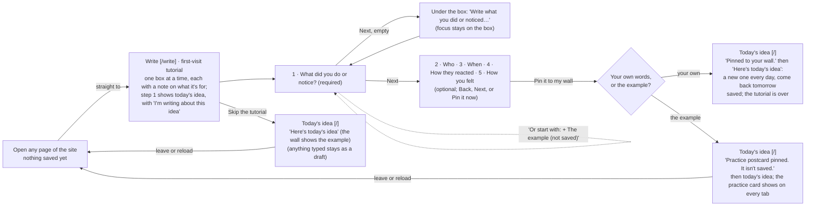
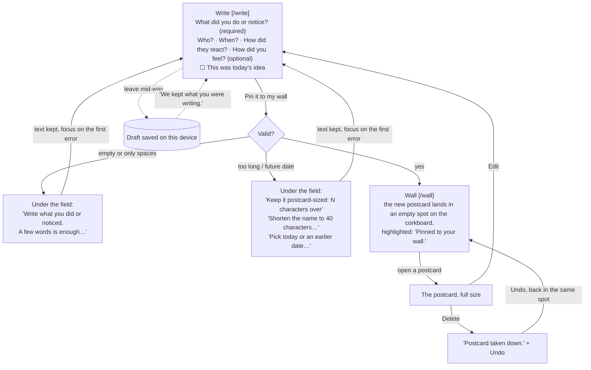
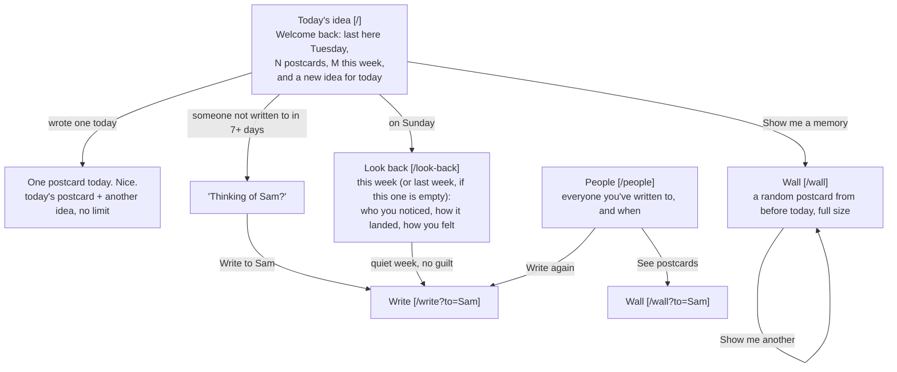

# Kind Regards: User Flows

**Main task:** I do something kind → I write it on a postcard → it's pinned to my wall → I come back tomorrow for a new idea, and on Sunday I look back at everyone I appreciated.

Each box with a route in brackets is a page. Every page shares the same nav: Today's idea · Write · Wall · People · Look back.

### 1 · First visit: useful right away

### 2 · Main task: write it down and pin it

### 3 · Coming back: it remembers

## States each page handles

| Page | States |
|---|---|
| Today | Loading (a brief skeleton while localStorage is read) · first visit (goes straight to the Write tutorial) · nothing saved after practice (one button and the idea) · returning · wrote one today · Sunday ("For you" idea; links to last week if this week is empty) · person to revisit |
| Write | First-visit tutorial (one box at a time, example offered, practice not saved, Skip; the other tabs are off until it's finished or skipped) · new · prefilled name (`?to=`) · edit (`?edit=`) · edit of a deleted postcard · draft restored · errors · Earlier date · Other feeling |
| Wall | Practice postcard (labeled, removable, not saved) · empty (an example postcard on the board, labeled) · board · full board (cards overlap, newest on top) · postcard opened · a memory · just pinned · updated · deleted with Undo · filtered by person |
| People | No names yet (only strangers, or none) · list, with "7+ days" marked |
| Look back | This week · last week · a quiet week (no guilt) · edited (back on that postcard's week) · deleted with Undo |
| Every page | The browser won't save (private mode): a notice that postcards won't be kept |
